<div align="center">
  

  # Vantage
</div>

Local-first SSH, VNC, and RDP client. The desktop app stores its own inventory. [vantaged](#vantaged) is the same app as a server, for a browser UI and for syncing that inventory between machines.

VNC and RDP require [guacd](https://guacamole.apache.org/doc/gug/guacamole-docker.html). Vantage does not ship it. Set **guacd address** in Settings (`host:4822`).

Downloads: [GitHub Releases](https://github.com/jdbnet/vantage/releases).

## Desktop

| Platform | Install |
| --- | --- |
| Windows | Run `vantage_*_windows_amd64-setup.exe` |
| macOS | Unzip and move **Vantage** to Applications. The build is unsigned: right-click, then Open, the first time |
| Linux (.deb) | `sudo apt install ./vantage_*_amd64.deb`, or the APT repo below |
| Linux (binary) | `chmod +x vantage_*_linux_amd64 && ./vantage_*_linux_amd64` |

```bash
curl -fsSL https://apt.jdbnet.co.uk/install/stable.sh | sudo bash
sudo apt update
sudo apt install vantage
```

The Linux builds need GTK 3 and WebKitGTK 4.1. The bare binary copies itself to `~/.local/share/vantage/` on first launch and adds an application menu entry. No root required.

On first launch, create the operator account, then add identities and hosts. For VNC or RDP, point Settings at guacd.

Desktop guacd on the same machine. The bind mount must be the desktop shared folder, because that path is the RDP drive:

```bash
docker run -d --name guacd -p 4822:4822 \
  -v "$HOME/.local/share/vantage/shared:$HOME/.local/share/vantage/shared" \
  guacamole/guacd:1.6.0
```

Leave **Drive path inside guacd** blank when that path matches. If Settings points at vantaged's guacd instead, the guest uses vantaged's `/data/shared`.

## vantaged

Headless server and browser UI. Published as a container. `linux/amd64` and `linux/arm64`. Tags are the release version and `latest`.

```bash
docker run -d --name vantaged \
  -p 7687:7687 \
  -v vantaged-data:/data \
  ghcr.io/jdbnet/vantaged:latest
```

Open `http://127.0.0.1:7687` and create the operator account.

RDP needs guacd on the same Docker network. The drive path is `/data/shared` in both containers:

```yaml
services:
  vantaged:
    image: ghcr.io/jdbnet/vantaged:latest
    ports:
      - "7687:7687"
    volumes:
      - ./data:/data
  guacd:
    image: guacamole/guacd:1.6.0
    volumes:
      - ./data/shared:/data/shared
```

Set **guacd address** to `guacd:4822`. Leave **Drive path inside guacd** blank.

vantaged runs as UID 65532. guacamole/guacd runs as UID 1000. The data directory must be writable by 65532. Only `data/shared` must be writable by both. Do not make the rest of `data` world-writable; that directory holds the SQLite vault.

```bash
mkdir -p data/shared
sudo chown 65532:65532 data
chmod a+x data
chmod -R a+rwX data/shared
```

A named volume for `/data` works the same way: create `/data/shared` on first start, then fix ownership. A bind mount owned by your login user fails with `unable to open database file (14)`.

## Sync

On vantaged, create an API key with the `sync` scope. In the desktop Settings, set the vantaged URL and that key. Folders, hosts, tags, identities, remotes, snippets, and known hosts replicate both ways. Last write wins.

Shared files land in the desktop data folder:

- Linux: `~/.local/share/vantage/shared`
- Windows: `%LOCALAPPDATA%\vantage\shared`
- macOS: `~/Library/Application Support/vantage/shared`
